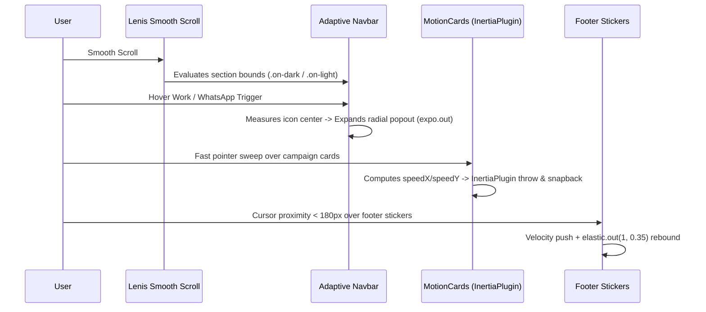

# MOXIE — Technical Architecture Deep-Dive

This document explains how **MOXIE** (`moxie.agency`) orchestrates **Next.js 15**, **React 19**, **GSAP + InertiaPlugin + ScrollTrigger**, and **Lenis** to deliver a tactile, 60 FPS culture-first creative agency experience.

---

## 1. Motion &amp; Interaction Architecture

---

## 2. Core Interactive Systems

### A. Adaptive Navbar &amp; Origin-Measured Popouts (`Navbar`)
- Dynamically toggles `.on-dark` and `.on-light` classes by comparing `window.scrollY + navbar.offsetHeight / 2` against each section's live bounding rect (Hero, Content, Showreel, Service Cards, Double Marquee, Footer).
- Both the `Work` popout (featuring *Velvet Soda*, *Kinetix*, and *Nova Audio*) and the contact popout measure the exact center of their trigger icon relative to the popout box (`transformOrigin`), creating an organic radial expansion on hover.
- Interactive micro-wiggles (`steps(1)` alternating rotation) give badges, buttons, and the `MOXIE` wordmark a hand-crafted stop-motion feel.

### B. Full-Bleed Campaign Hero &amp; Cinematic Showreel (`VimeoHero` &amp; `Showreel`)
- **Hero**: Full-bleed campaign photography (`/images/hero-campaign.png`) paired with a dark editorial vignette gradient so the white word-by-word headline (*"we make culture for the new mainstream"*) and SVG stickers stay crisp at any viewport size.
- **Showreel**: Full-bleed cover (`/images/showreel-cover.png`), top agency metadata bar (`MOXIE REEL 04 — 01:42 · NEW YORK · 2026`), and an interactive `PLAY REEL · 2026` toggle pill in Royal Violet (`#5B2EFF`) and Electric Pistachio (`#D9FF66`).

### C. Kinetic Motion Cards (`MotionCards`)
- Tracks real-time pointer velocity (`e.clientX - lastX`, `e.clientY - lastY`) on each of the 4 campaign cards and floating culture labels.
- On `mouseleave`, fires `gsap.to(..., { inertia: { x, y, rotation } })` so elements react with physical momentum before settling cleanly back to their resting transform.

### D. Footer Sticker Proximity Physics (`Footer`)
- On scroll entry (`top 80%`), 6 custom stickers pop up with `back.out(1.7)` stagger.
- When the cursor moves within `180px` at speed `> 3px/frame`, each sticker computes directional falloff (`1 - dist / 180`), pushes away with clamped force, and rebounds with `elastic.out(1, 0.35)`.

---

## 3. Design System Tokens

| Role | Color | Hex |
| :--- | :--- | :--- |
| **Editorial Surface** | Warm Chalk | `#F7F5F0` |
| **Dark Canvas** | Deep Ink | `#0E0D14` |
| **Primary Brand Accent** | Royal Violet | `#5B2EFF` |
| **High-Voltage Highlight** | Electric Pistachio | `#D9FF66` |
| **Playful Pop Accent** | Electric Coral | `#FF5E4D` |
| **Secondary Accent** | MOXIE Emerald | `#0F6E56` |

---

> 🔒 Want to unlock access to the complete downloadable Next.js 15 source code? See **[`CONTRIBUTING.md`](./CONTRIBUTING.md)**.
