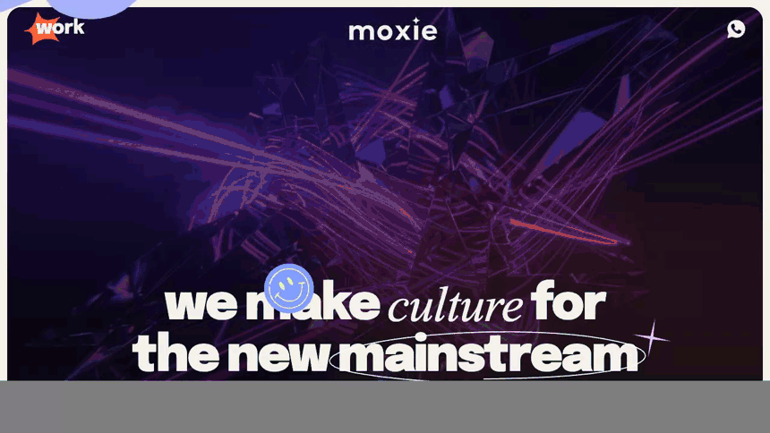
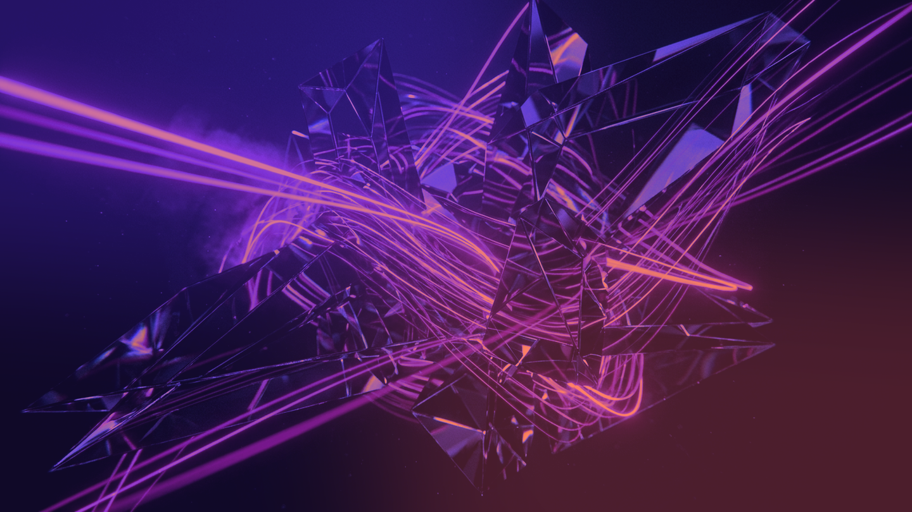
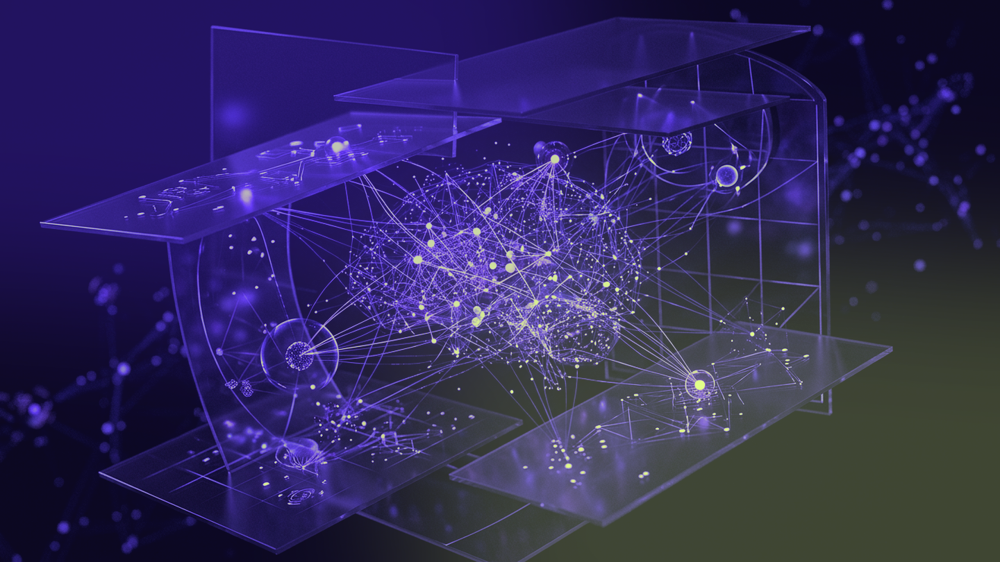
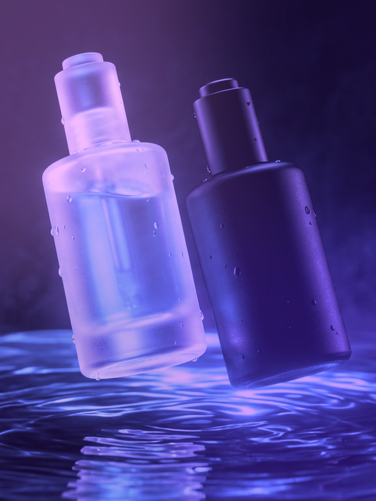
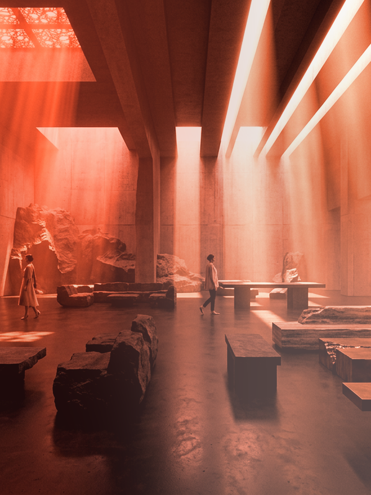
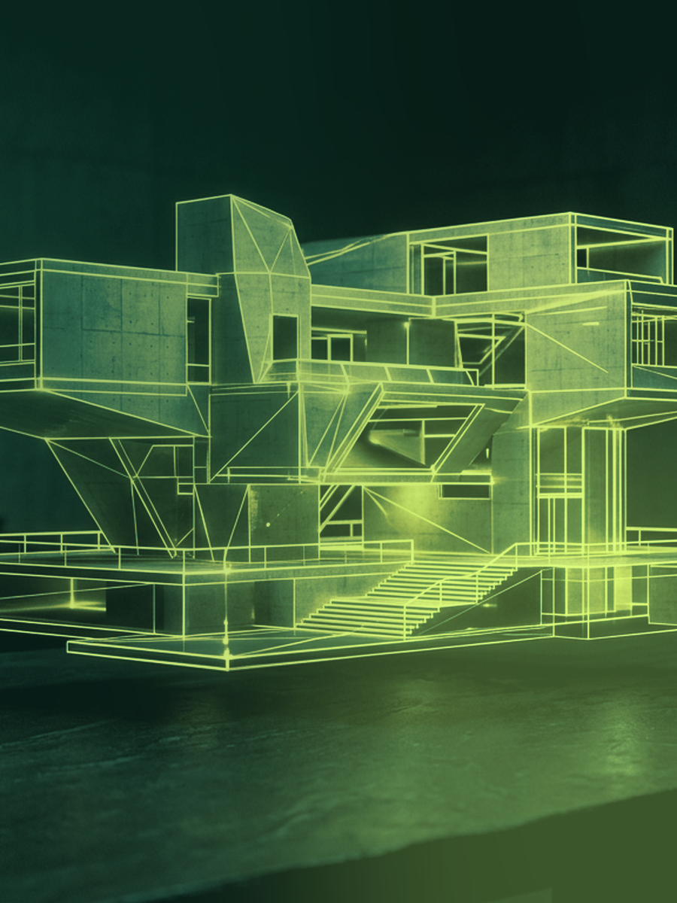
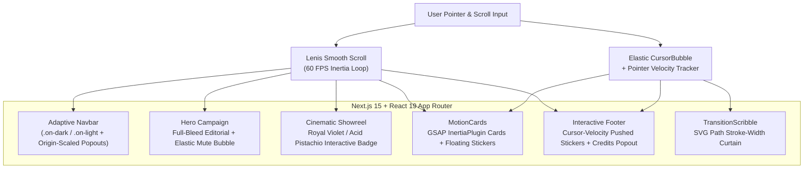

<div align="center">
  

  <h1>MOXIE — Culture-First Creative Agency Experience</h1>

  <p>
    <strong>GSAP Inertia Physics + Kinetic Motion Cards + Elastic Cursor Bubbles + SVG Transition Scribbles + Lenis Smooth Scroll in Next.js 15 &amp; React 19 — We make culture for the new mainstream.</strong>
  </p>
  <p>
    <sub><em>Agencia Creativa de Nueva Generación · Estética Warm Chalk × Royal Violet × Electric Coral × Acid Pistachio · 60 FPS</em></sub>
  </p>

  <p>
    <a href="https://annoris.github.io/moxie/">
      
    </a>
    &nbsp;
    <a href="https://github.com/annoris/moxie">
      
    </a>
  </p>

  <p>
    <a href="https://github.com/annoris/moxie/stargazers">
      
    </a>
    <a href="https://github.com/annoris/moxie/network/members">
      
    </a>
    <a href="https://github.com/annoris/moxie/issues">
      
    </a>
    <br />
    
    
    
    
    
  </p>

  <p>
    <a href="#-whats-inside-the-engine-curiosity-teasers">Engine Teasers</a> ·
    <a href="#-explore-the-public-moxie-visual-vault">Visual Vault (<code>moxie/</code>)</a> ·
    <a href="#-system-architecture">Architecture</a> ·
    <a href="./ARCHITECTURE.md">Technical Deep-Dive</a> ·
    <a href="#-contribute-to-unlock-full-source-code">Contribute-to-Unlock</a>
  </p>
</div>

---

<div align="center">
  
  <br />
  <h3>⭐ Star this repo if you love playful GSAP Inertia physics, kinetic typography &amp; bold brand systems!</h3>
  <sub><em>Explora la experiencia en vivo en <a href="https://annoris.github.io/moxie/">annoris.github.io/moxie</a> y descubre la arquitectura y visuales abiertos en <code>./moxie/</code>.</em></sub>
</div>

---

## 🔥 What's Inside the Engine (Curiosity Teasers)

Click any module below to peek inside **MOXIE**'s interactive motion engine — tactile Next.js 15 + GSAP micro-interactions distilled without spoiling the private source:

<details>
<summary><strong>🃏 1. GSAP Inertia Physics + Kinetic Motion Cards (Pointer-Velocity Throw &amp; Snapback)</strong></summary>

<br />

Hovering and sweeping across **MOXIE**'s editorial campaign cards and floating stickers captures real pointer velocity (`speedX`, `speedY`) and launches them with **`GSAP InertiaPlugin`** momentum before snapping back with organic spring physics:

```js
gsap.to(card, {
  inertia: {
    x: { velocity: speedX * 20, end: startX },
    y: { velocity: speedY * 20, end: startY },
    rotation: { velocity: speedX * 1.5, end: startRotation },
  },
});
```

Every card and floating badge feels physically weighted — never stiff, never robotic.

</details>

<details>
<summary><strong>🫧 2. Interactive Elastic Cursor Bubble &amp; Hand-Drawn SVG Transition Scribble</strong></summary>

<br />

A `gsap.quickTo`-driven elastic cursor bubble follows pointer movement across interactive surfaces, while a full-screen hand-drawn **SVG Transition Scribble** animates `stroke-width` from `8% → 31%` to paint over the viewport during playful brand transitions:

```js
const xTo = gsap.quickTo(bubble, 'x', { duration: 0.5, ease: 'power3' });
const yTo = gsap.quickTo(bubble, 'y', { duration: 0.5, ease: 'power3' });
gsap.to(bubble, { opacity: 1, scale: 1, rotation: 0, duration: 1.7, ease: 'elastic.out(1, 0.4)' });
```

</details>

<details>
<summary><strong>🎨 3. Warm Chalk × Royal Violet × Electric Coral × Acid Pistachio Design System</strong></summary>

<br />

MOXIE breaks away from generic monochrome templates with an unmistakable New York culture-agency palette:

- **Warm Chalk** (`#F7F5F0`) — Editorial paper canvas
- **Deep Ink** (`#0E0D14`) — High-contrast obsidian surface for Hero, Showreel &amp; Footer
- **Royal Violet** (`#5B2EFF`) — Signature Showreel &amp; popout interactive anchor
- **Electric Pistachio** (`#D9FF66`) — High-voltage accent badge &amp; hover state
- **Electric Coral** (`#FF5E4D`) &amp; **Emerald** (`#0F6E56`) — Playful campaign stickers &amp; accents

</details>

<details>
<summary><strong>🌀 4. Lenis Smooth Scroll + Adaptive Navbar Contrast Choreography</strong></summary>

<br />

Lenis smooth scrolling synchronizes with a scroll-aware **Navbar** that dynamically flips between `.on-dark` and `.on-light` modes across Hero, Content, Showreel, Service Cards, Double Marquee, and Footer — while radial popout menus expand directly from their icon origin (`transformOrigin`) using measured DOM rects.

</details>

---

## 🖼️ Explore the Public `moxie/` Visual Vault

All bespoke SVG brand marks and campaign visuals are **openly browsable inside [`./moxie/`](./moxie/)**:

### Hero &amp; 2026 Showreel

| Editorial Hero (`moxie/hero-campaign.png`) | Showreel Cover (`moxie/showreel-cover.png`) |
| :---: | :---: |
|  |  |

### Kinetic Campaign Cards (`MotionCards`)

| Velvet Soda — Sip Loud (`motion1.png`) | Kinetix — Street Pulse (`motion2.png`) | Nova Audio — Sound in Color (`motion3.png`) | Culture Activation NYC (`motion4.png`) |
| :---: | :---: | :---: | :---: |
|  |  |  |  |

---

## 🧠 System Architecture



> 📖 Dive deeper into every motion curve, sticker physics formula, and component contract in **[`ARCHITECTURE.md`](./ARCHITECTURE.md)**.

---

## 🔒 Contribute-to-Unlock Full Source Code

This public repository (**[`annoris/moxie`](https://github.com/annoris/moxie)**) lets you **experience the live site ([`annoris.github.io/moxie`](https://annoris.github.io/moxie/)), study the architecture, and inspect all campaign visuals inside [`./moxie/`](./moxie/)**.

**The complete downloadable source code is not publicly exposed here.** Access to the full Next.js 15 + GSAP Inertia codebase is reserved exclusively for **approved contributors** who add value to the community:

- 🛠️ **Submit a High-Signal Pull Request** in [`annoris/moxie`](https://github.com/annoris/moxie) (architecture diagrams, GSAP Inertia / SVG guides, performance notes, or translations).
- 🧠 **Open a Detailed Technical or UX Audit Issue** in [`annoris/moxie/issues`](https://github.com/annoris/moxie/issues).
- 🤝 **Collaborate or Sponsor** directly via **[`CONTRIBUTING.md`](./CONTRIBUTING.md)**.

👉 **Read [`CONTRIBUTING.md`](./CONTRIBUTING.md) for the exact step-by-step Contribute-to-Unlock process.**

---

## 📣 Share MOXIE

Love bold agency design, GSAP Inertia physics, and tactile Next.js 15 motion? Share **MOXIE**:

<div align="center">
  <a href="https://twitter.com/intent/tweet?text=Just%20checked%20out%20MOXIE%20%E2%80%94%20a%20culture-first%20Next.js%2015%20%2B%20GSAP%20Inertia%20%2B%20Lenis%20agency%20experience%20with%20elastic%20cursor%20bubbles%20%26%20kinetic%20cards%20%F0%9F%94%A5%20Live%20demo%3A&url=https%3A%2F%2Fgithub.com%2Fannoris%2Fmoxie&hashtags=NextJS,GSAP,WebDesign,CreativeCoding,Awwwards">
    
  </a>
  &nbsp;
  <a href="https://www.linkedin.com/sharing/share-offsite/?url=https%3A%2F%2Fgithub.com%2Fannoris%2Fmoxie">
    
  </a>
  &nbsp;
  <a href="https://annoris.github.io/moxie/">
    
  </a>
</div>

<br />

<div align="center">
  <sub><strong>MOXIE Agency</strong> · 148 Mercer Street, 10012 New York · <a href="mailto:hello@moxie.agency">hello@moxie.agency</a> · @teammoxie</sub>
</div>

---

## 🌐 Explore the JAP INTERNATIONAL & Annoris Ecosystem

Built by **JAP INTERNATIONAL** — Local-First AI Automation Platforms for Small & Medium Businesses (SMBs), agencies, clinics, e-commerce, and enterprise teams, alongside 60 FPS Creative Web Engineering showcases. Every project below includes an instant **Live Demo (zero login required)**.

### 🤖 AI & Local-First Business Automation
| Project | What It Solves | Stack | Live Demo |
| :--- | :--- | :--- | :---: |
| [**`aetheris`**](https://github.com/annoris/aetheris) | 77 AI Agents, 328 Skills & Local-First Automation Control Plane | Bun · Node · Ollama · MCP | [Live Demo ↗](https://annoris.github.io/aetheris/) |
| [**`aurelia`**](https://github.com/annoris/aurelia) | Self-Hosted Business AI Automation, RAG, Workflows & Local CRM | React 18 · Express · Prisma | [Live Demo ↗](https://annoris.github.io/aurelia/) |
| [**`lumenpitch`**](https://github.com/annoris/lumenpitch) | AI Presentation Studio & Multi-LLM Slide Generation Engine | Next.js 16 · FastAPI · Electron | [Live Demo ↗](https://annoris.github.io/lumenpitch/) |
| [**`tabvento`**](https://github.com/annoris/tabvento) | Autonomous AI Browser Automation Dashboard (Local-First BYOK) | Python · Playwright · SQLite | [Live Demo ↗](https://annoris.github.io/tabvento/) |
| [**`trading-bauhaus-journal`**](https://github.com/annoris/trading-bauhaus-journal) | AI Trading Journal with Claude/OpenAI Analyst & OHLC Replay | Next.js 15 · TypeScript · SQLite | [Live Demo ↗](https://annoris.github.io/trading-bauhaus-journal/) |

### 🎨 Creative Engineering & 60 FPS Web Showcases
| Project | Experience & Motion Engineering | Stack | Live Demo |
| :--- | :--- | :--- | :---: |
| [**`kairo`**](https://github.com/annoris/kairo) | 60 FPS Spatial Web: Navier-Stokes Fluid, GLSL Shaders & Rapier 3D | Next.js 14 · Three.js · GLSL | [Live Demo ↗](https://annoris.github.io/kairo/) |
| [**`valence`**](https://github.com/annoris/valence) | Zero-Bundler 60 FPS Awwwards Agency Template (MIT) | HTML5 · CSS3 · GSAP · Lenis | [Live Demo ↗](https://annoris.github.io/valence/) |
| [**`luma`**](https://github.com/annoris/luma) | Zero-Dependency Botanical Brand Experience + 106 BPM Web Audio Synth | HTML5 · CSS3 · Web Audio API | [Live Demo ↗](https://annoris.github.io/luma/) |
| [**`valtor`**](https://github.com/annoris/valtor) | Luxury Automotive Digital Flagship — 60 FPS GSAP + SplitText | Vite · ES Modules · GSAP | [Live Demo ↗](https://annoris.github.io/valtor/) |
| [**`solterra`**](https://github.com/annoris/solterra) | Luxury Desert Architecture Showcase — GSAP ScrollSmoother | React 19 · Vite 6 · Tailwind 4 | [Live Demo ↗](https://annoris.github.io/solterra/) |
| **`moxie`** *(You are here)* | Bold Social-First Creative Agency Experience — GSAP Inertia | Next.js 15 · React 19 · Lenis | [Live Demo ↗](https://annoris.github.io/moxie/) |
| [**`kineta`**](https://github.com/annoris/kineta) | Locked-60fps Brutalist Editorial Showcase & Variable Font Physics | Vanilla JS · GSAP · Lenis | [Live Demo ↗](https://annoris.github.io/kineta/) |
| [**`solmora`**](https://github.com/annoris/solmora) | Editorial Mediterranean E-Commerce Showcase (MIT, Zero-Deps) | HTML5 · CSS3 · Vanilla JS | [Live Demo ↗](https://annoris.github.io/solmora/) |

> ⭐ **Enjoyed exploring this project?** Drop a **Star** on GitHub and check out the full portfolio at [**github.com/annoris**](https://github.com/annoris) — it helps other builders discover the ecosystem!
